# QuantVol

**A regime-aware, vectorized backtesting framework for systematic strategies, built around look-ahead-safe execution, explicit cost modelling and stress testing.**

[](https://github.com/shreyescodes/vol-regime-backtester/actions/workflows/ci.yml)


[](LICENSE)

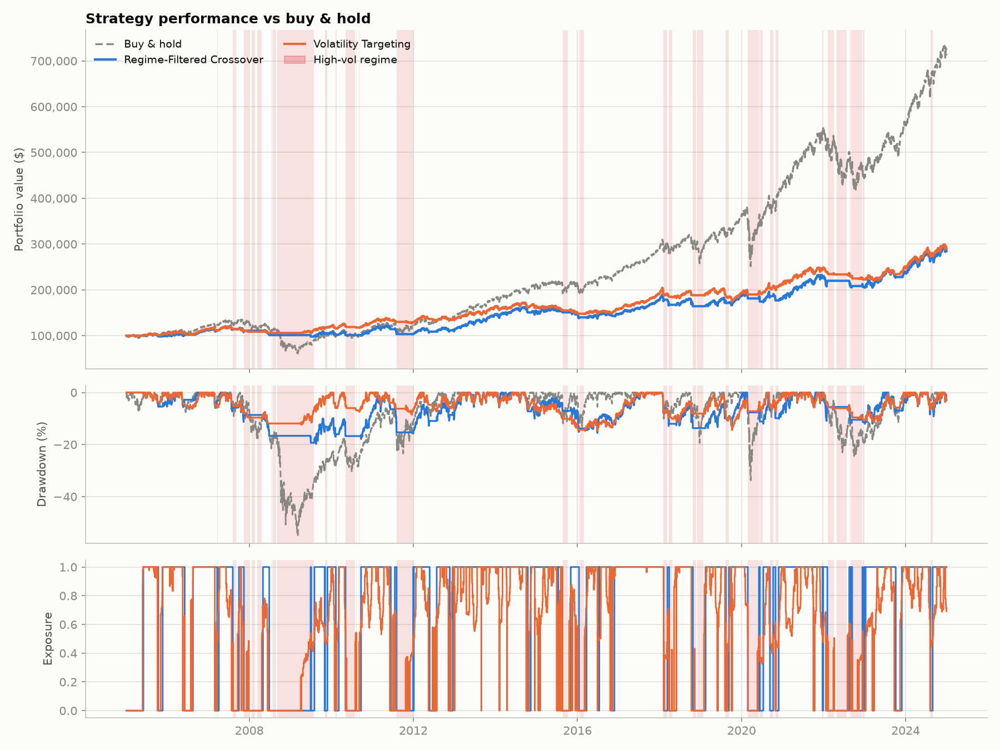

QuantVol answers one question carefully: **does conditioning a long-only strategy on the market's volatility regime change its risk profile, and would you have known that out-of-sample?** It classifies each bar as low, medium or high volatility from trailing realized volatility, runs two regime-aware strategies against buy-and-hold, and reports performance net of costs, by regime, under stress, and under walk-forward parameter selection.

## Results on real data (SPY, 2005-2024)

5,032 daily bars including 2008, 2011, 2020 and 2022. Costs: 5 bps per unit of turnover. Signals are lagged one bar. Config: [`configs/spy.yaml`](configs/spy.yaml).

| Strategy | CAGR | Sharpe | Sortino | Max drawdown | Calmar |
|---|---:|---:|---:|---:|---:|
| Buy & hold | 10.3% | 0.51 | 0.71 | -55.2% | 0.19 |
| Regime-filtered MA crossover (20/100) | 5.4% | 0.37 | 0.49 | -19.8% | 0.27 |
| Volatility targeting (10%) | 5.5% | 0.44 | 0.59 | -14.8% | 0.37 |

**What this shows, and what it does not.** Both strategies cut the worst drawdown by roughly 35-40 percentage points and improve Calmar, but they **underperform buy-and-hold on return and Sharpe** over a 20-year equity bull market. That is the expected trade for a defensive overlay, and it is reported as is. The value here is the risk profile and the evidence behind it, not a claim of alpha. Parameters were not optimized on this result; the sweep and walk-forward below show how much that choice matters.

<p align="center">
  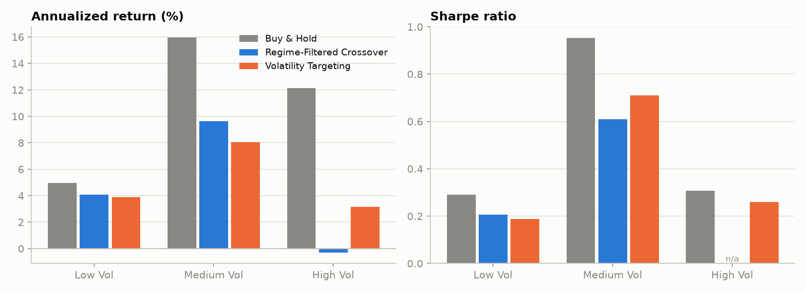
  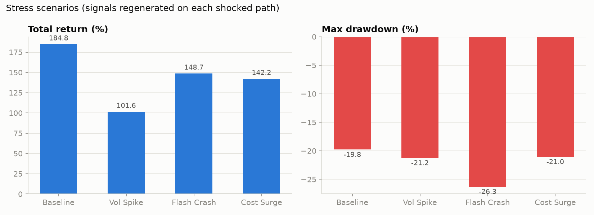
</p>

* **By regime (left):** the crossover is flat in the high-volatility regime. That avoids crash losses, but high-volatility regimes also contain sharp rebounds (buy-and-hold earned about +12% annualized there when grouped by the regime known at the prior close), so the filter gives up some recovery. Sharpe is shown as undefined for a flat book.
* **Stress (right):** signals are regenerated on each shocked path. The 5x cost surge costs about 43 points of total return; a 10% one-day crash deepens the drawdown from -19.8% to -26.3%.

### Robustness: parameter sweep and walk-forward

<p align="center">
  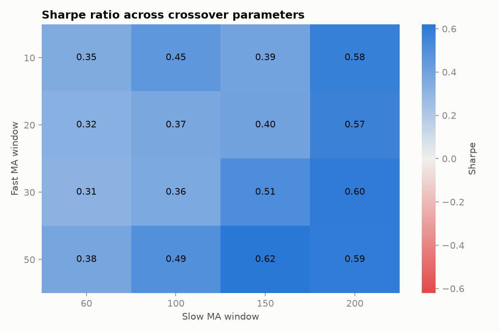
  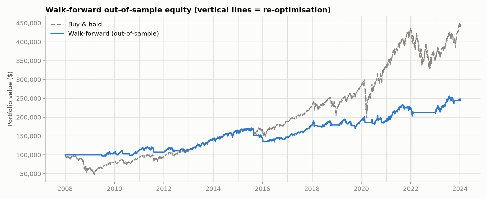
</p>

Sharpe is positive across the whole 4x4 window grid (0.31 to 0.62), so the result does not hinge on one lucky cell. The walk-forward test re-selects `(fast, slow)` every year on the previous three years and trades it on the next. It produced a 5.8% CAGR and 0.41 Sharpe out-of-sample, in line with the fixed-parameter crossover (5.4% / 0.37), even though nine different parameter pairs were chosen across the 16 folds. So the result does not appear to depend on picking one parameter set in hindsight, but 16 annual folds is a small sample and this is not proof.

## Interactive dashboard

```bash
quantvol dashboard        # or: streamlit run app/dashboard.py
```

<p align="center">
  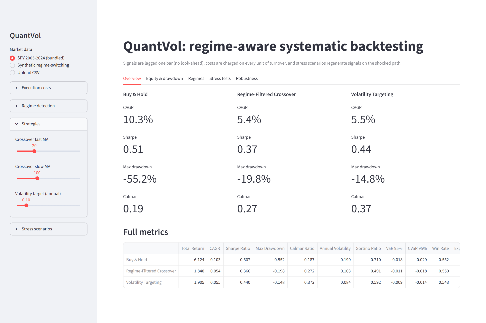
  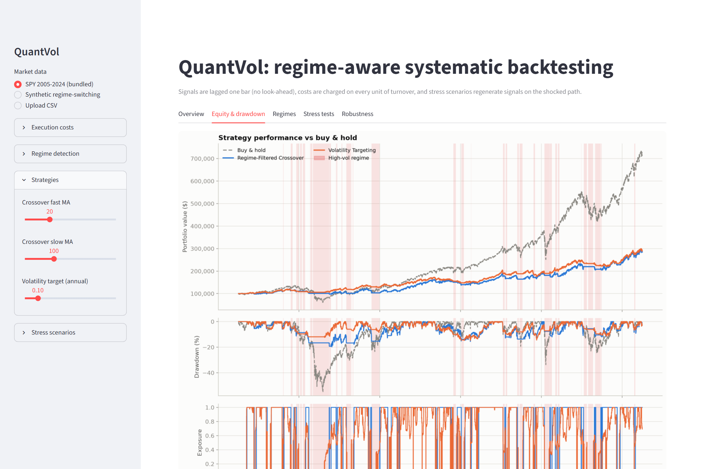
</p>
<p align="center">
  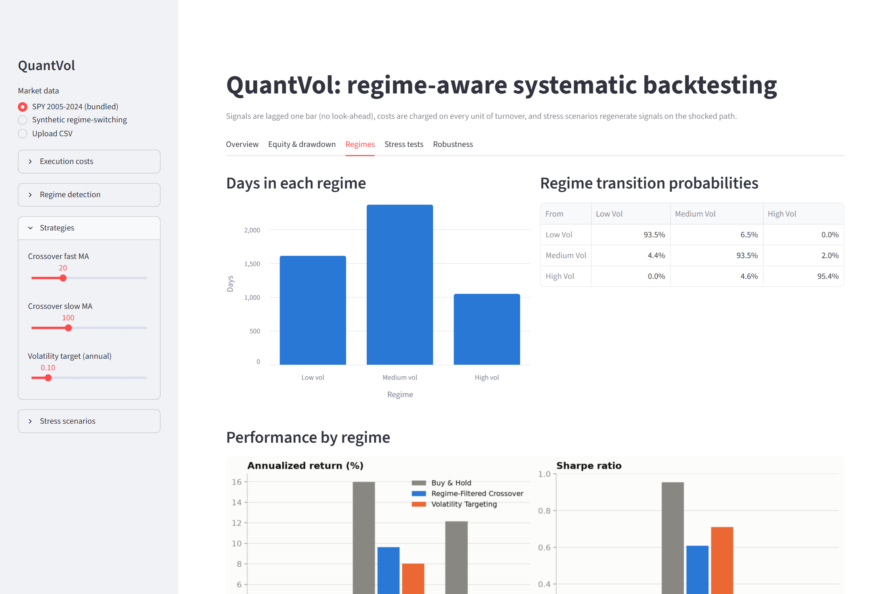
  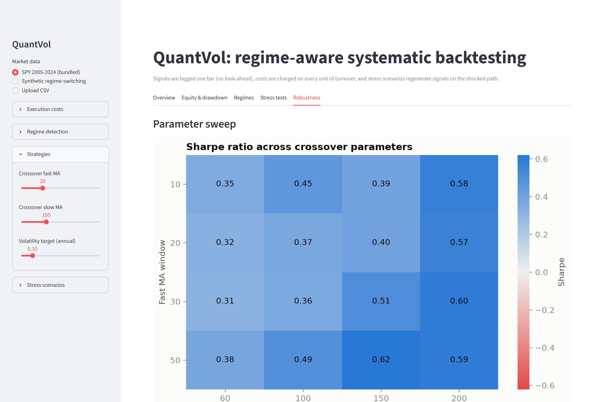
</p>

The dashboard runs the same `run_pipeline` as the CLI. Switch between the bundled SPY sample, a synthetic regime-switching series, or your own CSV/Excel file, and adjust costs, regime thresholds, strategy windows and stress parameters from the sidebar.

## Engineering

| Concern | How it is handled |
|---|---|
| **No look-ahead** | Signals are lagged by `execution_lag >= 1` bars; `0` is rejected at config load. Regimes and indicators use trailing windows only. Tests corrupt all future prices and assert that regimes, signals and equity up to *t* are unchanged. |
| **Costs** | Commission and slippage are charged on every unit of turnover. The benchmark pays the same entry cost, so comparisons are like for like. |
| **Immutability** | `Backtester` and all config sections are frozen dataclasses. Stress scenarios run on copies, so a failure cannot leave mutated state behind. |
| **Configuration** | Everything tunable is a validated YAML field; unknown keys, bad ranges and inconsistent thresholds fail with a clear message. |
| **Single orchestration path** | The CLI and the dashboard both call `quantvol.pipeline.run_pipeline`. |
| **Typing and style** | `mypy --strict` on `src/`, `ruff` lint and format, `py.typed` marker. |
| **Tests** | 59 tests: hand-computed P&L, golden metric values, [Hypothesis](https://hypothesis.readthedocs.io) properties (weights in `[0, 1]`, equity positive), look-ahead and walk-forward leakage checks, config validation, CLI smoke tests. 95% branch coverage with an 85% gate. |
| **CI** | GitHub Actions: lint, type-check, tests on Python 3.10-3.12, wheel build with `twine check`, Docker build. |
| **Reproducibility** | Seeded local RNG (global NumPy state untouched), bundled data sample, tests and CI never use the network. |

<p align="center">
  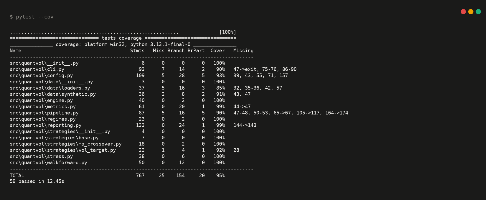
</p>

*The terminal images in this README are rendered from captured output of the commands shown (`scripts/build_docs_assets.py`), and the dashboard screenshots are taken from the running app (`scripts/capture_dashboard.py`).*

## Quick start

```bash
git clone https://github.com/shreyescodes/vol-regime-backtester.git
cd vol-regime-backtester
python -m venv .venv && source .venv/bin/activate      # Windows: .venv\Scripts\activate
pip install -e ".[dev,app,data]"

quantvol run --config configs/spy.yaml --out reports/spy   # full report: tables + figures
quantvol sweep --config configs/spy.yaml                   # Sharpe grid over crossover windows
quantvol walkforward --config configs/spy.yaml             # rolling out-of-sample test
quantvol dashboard                                         # Streamlit UI
```

<p align="center">
  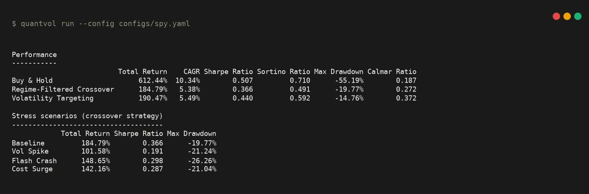
</p>

`quantvol run` writes `metrics.csv`, `stress.csv`, regime attribution tables, `summary.json` and the figures above to the output directory.

### Use it as a library

```python
from dataclasses import asdict

from quantvol import Backtester, RegimeFilteredMovingAverageCrossover, detect_regimes, load_config
from quantvol.data import load_csv_data

cfg = load_config("configs/spy.yaml")
data = load_csv_data("data/sample/spy_2005_2024.csv")

regimes = detect_regimes(data, **asdict(cfg.regime))
strategy = RegimeFilteredMovingAverageCrossover(**asdict(cfg.crossover))
result = Backtester(**asdict(cfg.backtest)).run(data, strategy.generate_signals(data, regimes))

print(result.metrics["Sharpe Ratio"], result.metrics["Max Drawdown"])
```

### Docker

```bash
docker build -t quantvol .
docker run --rm -v "$PWD/reports:/home/quant/reports" quantvol      # runs the SPY report
```

### Your own data

Provide a CSV with a date column and at least `Close` (`Open`, `High`, `Low`, `Volume` optional), then point a config at it:

```yaml
data: {source: csv, csv_path: path/to/prices.csv}
regime: {low_thresh: 0.10, high_thresh: 0.20}   # tune thresholds to the asset's volatility
backtest: {trading_days: 365}                    # 365 for crypto, 252 for equities
```

Optional Yahoo Finance download (`pip install -e ".[data]"`): `data: {source: yahoo, ticker: QQQ, start_date: "2010-01-01"}`. Downloads are cached under `data/cache/`.

## Project layout

```
src/quantvol/
  config.py        validated, frozen configuration dataclasses + YAML loader
  data/            synthetic Markov-switching GBM, CSV/Excel loader, optional Yahoo + cache
  regimes.py       causal volatility-regime classification, transition matrix
  strategies/      BaseStrategy, regime-filtered crossover, volatility targeting
  engine.py        look-ahead-safe, cost-aware vectorized backtester
  metrics.py       Sharpe/Sortino/Calmar/VaR/CVaR, turnover, per-regime attribution
  stress.py        vol spike, flash crash, cost surge (pure shocks, regenerated signals)
  walkforward.py   parameter sweep + rolling walk-forward validation
  reporting.py     figures
  pipeline.py      end-to-end orchestration and report writer
  cli.py           quantvol run | sweep | walkforward | dashboard
app/dashboard.py   Streamlit UI
configs/           spy.yaml (real data), default.yaml (synthetic)
tests/             pytest + Hypothesis
docs/              METHODOLOGY.md, ARCHITECTURE.md
```

See [docs/METHODOLOGY.md](docs/METHODOLOGY.md) for exact definitions (timing, regimes, costs, metrics, stress scenarios) and [docs/ARCHITECTURE.md](docs/ARCHITECTURE.md) for design decisions and how to add a strategy.

## Limitations

* Daily close-to-close execution; no intraday fills, market impact, financing or taxes.
* Single asset, long-only, unleveraged; no portfolio construction.
* The real-data result is one instrument over one 20-year window dominated by a bull market.
* The synthetic generator is a model of regimes, not of markets. It is used for tests and mechanics demos, and results on it are not evidence of live performance.
* Backtests are not predictions. Nothing here is investment advice.

## Roadmap

* Multi-asset portfolios with risk-parity and correlation-aware sizing
* Block-bootstrap confidence intervals for Sharpe and drawdown
* Hidden-Markov regime detection as an alternative to threshold rules
* Short and leverage-constrained strategy variants

## Contributing and license

See [CONTRIBUTING.md](CONTRIBUTING.md) and [CHANGELOG.md](CHANGELOG.md). Released under the [MIT License](LICENSE).
