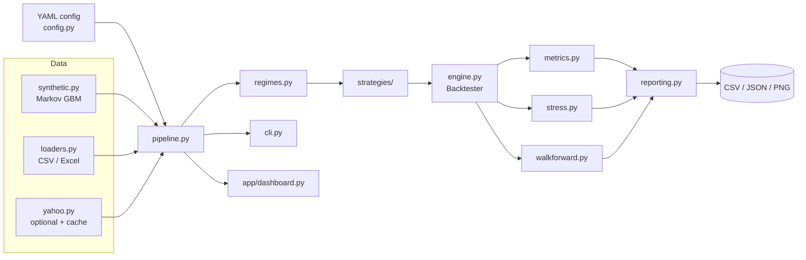

# Architecture



## Module responsibilities

| Module | Responsibility | Key types |
|---|---|---|
| `config.py` | Frozen dataclasses, YAML loading, validation with clear errors | `Config`, `ConfigError` |
| `data/` | Produce a standardized OHLCV frame from any source | `generate_synthetic_data`, `load_csv_data` |
| `regimes.py` | Causal volatility-regime labels, empirical transition matrix | `detect_regimes` |
| `strategies/` | Map data + regimes to target weights in `[0, 1]` | `BaseStrategy` |
| `engine.py` | Lag signals, charge costs, build equity curves | `Backtester`, `BacktestResult` |
| `metrics.py` | Performance, tail risk, per-regime attribution | `calculate_performance` |
| `stress.py` | Pure shock functions + scenario runner | `run_stress_tests` |
| `walkforward.py` | Parameter sweep, rolling walk-forward | `walk_forward` |
| `reporting.py` | Figures (headless Matplotlib) | `plot_*` |
| `pipeline.py` | Orchestrates a full run, writes the report | `run_pipeline` |
| `cli.py` | `quantvol run / sweep / walkforward / dashboard` | `main` |

## Design decisions

* **Immutable engine and config.** `Backtester` and every config section are frozen
  dataclasses. The earlier version mutated cost attributes during stress tests; scenarios now
  run on `dataclasses.replace` copies, so a failing scenario can never leave state behind.
* **Strategies are pure functions of data.** `generate_signals(data, regimes)` has no hidden
  state, which is what makes the look-ahead property testable by perturbing future prices.
* **One orchestration path.** The CLI and the Streamlit dashboard both call `run_pipeline`, so
  there is a single place where a run is defined and the two front ends cannot drift apart.
* **Config over constants.** Every tunable is a validated config field. Invalid values (such as
  `execution_lag: 0`) fail at load time, not mid-run.
* **Vectorized throughout.** No per-bar Python loops in the engine, stress shocks or metrics
  (the Markov chain in the synthetic generator is the one inherently sequential step).
* **Offline by default.** Tests and CI never touch the network; the Yahoo loader is an optional
  extra with an on-disk cache.

## Adding a strategy

```python
from quantvol.strategies import BaseStrategy


class Breakout(BaseStrategy):
    name = "Breakout"

    def __init__(self, window: int = 55) -> None:
        self.window = window

    def generate_signals(self, data, regimes):
        close = data["Close"]
        return (close > close.shift(1).rolling(self.window).max()).astype(float)


# weights are lagged and costed by the engine
result = Backtester().run(data, Breakout().generate_signals(data, regimes))
```

Run `pytest tests/test_lookahead.py` against it by adding it to the parametrized list.
